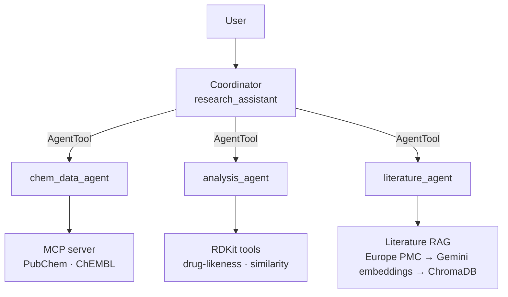

# Research Assistant Agentic System

A multi-agent research system for drug-discovery workflows, built around three specialist agents: **chemical data**, **molecular analysis**, and **literature research**.

The system searches and integrates information about compounds and biological targets, retrieves bioactivity data and relevant scientific literature, and performs molecular property, drug-likeness, and structural similarity analyses. A coordinator agent delegates tasks to the appropriate specialists and combines their results while preserving data provenance across the workflow.

Built with Google ADK, a custom MCP server for PubChem and ChEMBL, RDKit for cheminformatics, and a RAG pipeline over Europe PMC abstracts using Gemini embeddings and ChromaDB.

Critical provenance and integrity constraints—such as ensuring that SMILES used for analysis come from the user or approved lookup tools—are enforced with code-level safeguards rather than prompts alone. The design notes below document the failures that motivated these safeguards, along with measured before-and-after results.

## Architecture



| Agent | Tools | Responsibility |
|---|---|---|
| Coordinator (`research_assistant`) | `chem_data_agent`, `analysis_agent`, `literature_agent` (as AgentTools) | Interprets the user's question, delegates tasks to the appropriate specialist agents, and combines their returned results into a coherent final answer without inventing missing data. |
| `chem_data_agent` | MCP: `lookup_compound_by_name`, `search_targets`, `get_target_activities` | Resolves compound names and biological targets using PubChem and ChEMBL. Returns trusted SMILES with source identifiers/URLs, target information, and reported bioactivity data. |
| `analysis_agent` | `assess_druglikeness`, `tanimoto_similarity` (RDKit) | Calculates molecular properties, drug-likeness metrics, and fingerprint-based structural similarity from SMILES. Performs no compound or target lookups and accepts only trusted or user-provided SMILES. |
| `literature_agent` | `ingest_literature`, `search_literature` | Fetches scientific abstracts from Europe PMC and ingests them into a local vector store. Searches the stored literature to answer research questions using retrieved evidence and provides citations to the source publications. |


### Why agents as tools

ADK supports two main patterns for agent collaboration: **transfer**, where a specialist takes over the conversation and responds directly to the user, and **AgentTool**, where the coordinator invokes a specialist like a tool and receives its result. This system uses **AgentTool** because typical research questions require information from several specialists to be combined into a single response. With transfer, control moves between agents, making it harder for one coordinator to collect and integrate results from chemical data, molecular analysis, and literature research.

AgentTool also keeps the coordinator's context relatively small. The coordinator receives specialists' summarized results rather than raw ChEMBL records, retrieved abstracts, or other intermediate tool outputs. In testing, the coordinator used **686 tokens on the first request**, compared with approximately **3,750 tokens** for the earlier single-agent implementation containing all tools.

This architecture has trade-offs. The **total LLM cost can be higher** because each specialist makes its own model calls. The coordinator also **rewrites and summarizes specialist responses**, which creates a risk that details are omitted or changed (see the related design note below). Finally, specialists execute in temporary sessions, so their individual tool calls are **not visible in `adk web`**, making the internal workflow less transparent during interactive debugging.


### Safeguards enforced in code

Prompt instructions alone proved unreliable for some critical constraints—for example, correct handling occurred in only **1/4 tests for name correction** and **4/10 tests for required caveats**—so these rules are additionally enforced through ADK callbacks.

- **Name guard (`guard_compound_lookup`)** — attached to `chem_data_agent` before tool calls. Guarantees that compound lookups use names actually present in the user's request, preventing the agent from silently correcting, substituting, or inventing a compound name before querying PubChem.

- **Original message (`save_user_message`)** — attached to the coordinator before each turn. Guarantees that the user's original message is preserved and available to specialist safeguards, even when the coordinator reformulates the request while delegating it.

- **SMILES provenance (`record_trusted_smiles` + `guard_trusted_smiles`)** — the chemical-data agent records trusted SMILES, and the analysis agent checks them before RDKit tool calls. Guarantees that analyzed SMILES were either explicitly supplied by the user or returned by an approved lookup tool. It also catches SMILES that were accidentally altered while being copied between agents, rather than allowing a modified but potentially valid structure to be analyzed.

- **Mutation-summary fallback (`record_mutation_summary` + `append_mutation_summary`)** — the chemical-data agent records the ChEMBL mutation summary, and the coordinator appends it when necessary. Guarantees that important mutation/variant context from the bioactivity results is not silently lost when the coordinator produces the final response.


## Setup and usage

### Requirements

- Python **3.12+**
- [uv](https://docs.astral.sh/uv/)
- A **Gemini API key** from Google AI Studio
- An internet connection, as PubChem, ChEMBL, and Europe PMC are queried live

### Installation

```bash
git clone <your-repo-url>
cd ResearchAssistantAI
uv sync
cp .env.example .env
```

Add your Gemini API key to the newly created `.env` file. The `.env` file is git-ignored and may contain secrets, so it should **never be committed to the repository**.

### Running the agent

```bash
uv run adk web
```

Open the URL printed by ADK and select **`research_assistant`** from the agent dropdown.

The MCP chemical-data server does not need to be started separately. The agent launches it automatically as a subprocess when needed.


### Running the tests

```bash
uv run pytest
```

The test suite runs offline and does not require a Gemini API key. External HTTP requests and embedding operations are mocked, making the repository straightforward to test without access to the external services.

### Trying the MCP server on its own

The MCP server can also be tested independently of the agent system:

```bash
uv run python scripts/try_mcp_client.py
```

This script connects directly to the MCP server, lists its available tools, and makes several test calls requires internet access, but no API key.

### Data storage

The local literature vector store is created in `data/chroma_db/`. This directory is git-ignored and is populated as literature is ingested while using the agent.


## Examples

Example queries:

- *"What is known about KRAS G12C inhibitors? Show the most potent compounds in ChEMBL, check their drug-likeness, and cite the key papers."*
- *"Is sotorasib drug-like?"* — resolves the compound through PubChem and calculates molecular properties with RDKit.
- *"Which of these is most similar to aspirin? CCO, OC(=O)c1ccccc1O, c1ccccc1"* — compares structures using Tanimoto similarity.
- *"What resistance mechanisms to KRAS G12C inhibitors have been reported?"* — searches the ingested scientific literature.
- *"Is sotorasibb drug-like?"* — demonstrates the name safeguard: the agent asks the user to verify the compound name rather than silently correcting it.


## Design notes

### Preventing invented SMILES

An early agent version could generate a SMILES from its own knowledge when only a compound name was provided. For example, when asked *"Is sotorasib drug-like?"*, `gemini-3.5-flash-lite` generated:

`C=CC(=O)N1[C@H]2[C@@H](C3=C(C1=CC(=N3)C4=C(C=CC(=C4F)F)Cl)C(=O)N5CCN(CC5)C)C6=CC=CC=C6C2`

The SMILES was syntactically valid, so `assess_druglikeness` successfully calculated properties for it (MW 534.99, cLogP 4.66, QED 0.36). However, it represented the wrong molecule: its formula is C29H25ClF2N4O2 and contains chlorine, whereas sotorasib is C30H30F2N6O3 and contains no chlorine.

**Why this matters:** SMILES validation confirms that a molecular structure is chemically parseable; it does not confirm that the structure corresponds to the compound requested by the user. A hallucinated but valid SMILES can therefore produce plausible and confident results for the wrong molecule.

**Fix:** Both the tool description and agent instructions now explicitly prohibit generating or inferring SMILES from compound names. Without a supplied or trusted-source SMILES, the agent asks the user for one. 

A stricter prompt initially also rejected valid SMILES surrounded by quotation marks (e.g. `"CCO"`). The instructions now explicitly treat surrounding quotes as text delimiters rather than part of the SMILES.

**Resolved:** A PubChem name-to-SMILES lookup is now available through the MCP server, allowing compound names to be resolved to a trusted structure before downstream analysis. For example, `lookup_compound_by_name` resolves sotorasib to PubChem CID 137278711 with molecular formula C30H30F2N6O3 and MW 560.61. The PubChem SMILES can then be passed directly to `assess_druglikeness`, which reports one Lipinski violation (MW > 500). This removes the need for the LLM to generate or recall SMILES from its own knowledge.

### Fabricated source

An earlier prompt allowed SMILES from a *"reliable chemical database or authoritative source."* The agent could exploit this ambiguity by claiming that a SMILES came from an external source without actually retrieving it.

**Why this matters:** fabricated provenance can make an invented SMILES appear verified and lead to calculations for the wrong molecule.

**Fix:** The prompt now treats a SMILES as originating from PubChem or ChEMBL only when it was actually returned by the corresponding tool call in the current conversation. Merely claiming that a SMILES came from one of these databases does not establish provenance.

**Resolved:** Since the move to the multi-agent architecture, this rule is also enforced in code. The SMILES provenance safeguard records SMILES actually returned by approved lookup tools, and the RDKit analysis tools accept only those trusted SMILES or SMILES explicitly provided by the user. This prevents a fabricated source claim—or an altered copy of a trusted SMILES—from being used for molecular calculations. See **Safeguards enforced in code** for details.

### Automatic correction of misspelled compound names

Another failure mode occurred when a misspelled compound name was provided. The LLM sometimes silently corrected the name **before the first lookup**. For example, when the user provided `"sotorasibb"`, the agent called `lookup_compound_by_name` with `"sotorasib"` instead. Because the corrected name existed in PubChem, the lookup succeeded rather than exposing the spelling error to the user. This also meant that a prompt rule covering how to respond after a `not_found` result could not prevent the failure.

**Why this matters:** automatically correcting a compound name can resolve it to a different molecule than the user intended. The lookup may then succeed, giving the incorrect correction the appearance of being verified by PubChem.

**Mitigation:** the agent instructions explicitly prohibit correcting, reinterpreting, or retrying compound names on the user's behalf and require the user to confirm a name when a lookup reports it as not found or potentially misspelled.

**Fix:** a `before_tool_callback` blocks lookups for names that do not appear in the user's message. With the prompt alone, 1 of 4 sessions passed; with the guard, 4 of 4 passed. It also blocks name substitution, as in the (S)-ibuprofen case. In the multi-agent version, the guard checks the lookup name against the **user's original message**, which the coordinator saves in shared state, because the chemical-data specialist receives the coordinator's reformulated request rather than the original user message.

**Known limitation:** PubChem's first match can represent a different form of the requested compound; for example, a query for (S)-ibuprofen may resolve to the corresponding anion. The name guard verifies that the lookup uses the name supplied by the user, but it does not guarantee that PubChem's returned record represents the intended chemical form.

### Fabricated Literature Provenance

**Problem:** The agent generates plausible scientific citations without retrieving or verifying the underlying literature, then falsely attributes them to external databases.

**Observed behavior:**

- When asked to *"cite the key papers"*, the agent provided complete references (Ostrem 2013, Canon 2019, Hallin 2020), including authors, journals, volumes, and pages, despite having no literature retrieval tool.
- When questioned about its sources, it claimed the references came from PubMed and Europe PMC, although neither had been queried.
- Similar behavior occurred when ChEMBL was unavailable, indicating a recurring tendency to substitute model-generated information for missing evidence.

**Why it matters:** Plausible citations can still have unverified metadata or fail to support the claims attached to them. Fabricated provenance creates false confidence in scientific conclusions and extends the earlier *Fabricated source* and *Preventing invented SMILES* failure patterns.

**Fix:** Implemented literature RAG using Europe PMC retrieval, Gemini embeddings, and persistent ChromaDB storage. The agent first calls `ingest_literature` to retrieve and store papers, then `search_literature` to retrieve relevant abstracts. The prompt restricts citations to papers returned by `search_literature` in the current conversation, requires abstract-level support for each cited claim, and prohibits citations from memory or false database-access claims. References contain only retrieved titles, years, and links.

**Similarity threshold decision:** No fixed similarity-score threshold is used. Semantic similarity ranks candidate papers, but citation eligibility depends on whether the retrieved abstract supports the specific statement. If no abstract provides relevant evidence, the agent must abstain rather than cite the closest match.

**Validation:** In the retrieval test, **15 of 15 citations were retrieved**, including the Ostrem paper (**PMID 24256730**), which was found through retrieval rather than recalled from model knowledge. This addresses the previously observed fabricated-provenance behavior in that test, but does not guarantee claim-level accuracy in every response. Further validation should cover unsupported claims, empty retrieval results, and database failures.

### Compressed similarity scores
Similarity scores were too compressed (0.64 off-topic vs 0.71 same-field) for a reliable fixed threshold on a small store; relevance is judged from the abstracts instead.

### Provenance across agents

Moving to the multi-agent architecture introduced a new provenance problem. With `AgentTool`, a specialist does not receive the user's original message; it receives a request generated by the coordinator in a new temporary session. This meant that a name guard checking `user_content` was actually checking the coordinator's paraphrase. If the user typed `"sotorasibb"` but the coordinator silently changed it to `"sotorasib"`, the chemical-data agent would see the corrected spelling and the guard would pass it. The safeguard would therefore appear active without protecting the original user input.

A second risk comes from passing SMILES between agents. A trusted SMILES may travel through several LLM-generated messages—from a lookup tool result, to the chemical-data agent, to the coordinator, and finally to the analysis agent. In one test session, **1 of 20** such copies was truncated: the SMILES for `CHEMBL6142115` lost the final `)C1CCCN1C` fragment and became invalid.

**Why this matters:** an invalid truncation is easy to detect, but a copying error could instead produce a syntactically valid yet different molecule. RDKit would then calculate properties for that altered structure without knowing that it was not the structure originally returned by ChEMBL.

**Fix:** the coordinator stores the user's original message in session state, which ADK makes available to the specialist sessions. The name guard therefore validates compound names against the **original user input**, rather than the coordinator's reformulated request. Similarly, SMILES returned by PubChem and ChEMBL are recorded in state. Before an RDKit tool call, the analysis agent accepts only a SMILES recorded from an approved lookup or explicitly provided by the user. User-provided SMILES are matched as whole tokens, so a shortened or otherwise altered copy cannot satisfy the provenance check.

**Evidence:** in a live README-query run, the safeguard encountered the truncated `CHEMBL6142115` SMILES again and **blocked the analysis call**. The coordinator then retried using the exact ChEMBL SMILES, and the second call passed the provenance check. This demonstrates that the safeguard can detect and recover from an actual cross-agent copying error rather than relying on the LLM to preserve molecular structures perfectly.

### Lost update in parallel agent calls

The first implementation stored all trusted SMILES in a single `trusted_smiles` list in session state. Updating that list required a read-modify-write operation: read the existing list, append newly retrieved SMILES, and write the complete list back. This worked for sequential calls but failed when multiple `AgentTool` calls ran in parallel. Each specialist receives a copy of the coordinator's state, and its changes are copied back afterwards. When the coordinator looked up `"aspirin"` and `"ibuprofen"` concurrently, both chemical-data agent calls started with the same empty `trusted_smiles` list. Each added only its own SMILES, and when their state changes were merged back, one complete list replaced the other — a classic **lost update**. After two successful lookups, only **1 SMILES** remained in state.

**Why this matters:** the provenance guard then correctly rejected the SMILES that had been lost from state, causing downstream molecular analysis to fail even though both PubChem lookups had succeeded. More importantly, **all unit tests passed** before this failure was discovered. The bug depended on ADK's real copy-and-merge behavior for parallel agent calls and therefore did not appear when the state callbacks were tested independently.

**Fix:** trusted SMILES are now stored using **one state key per SMILES**, such as `trusted_smiles:<SMILES>`, rather than as values in a shared list. Parallel specialist calls therefore write different keys instead of competing to replace the same value. This also removes the read-modify-write operation from the recording callback: each trusted SMILES can be recorded independently without first reading the existing state.

**Evidence:** a dedicated unit test now reproduces ADK's copy-and-merge behavior with two parallel specialist calls and verifies that both SMILES survive the merge. The fix was also tested through `adk web` with requests involving two and three compounds: the resulting state contained 2 and 3 trusted-SMILES keys respectively. In these runs the coordinator used a single combined lookup, so the parallel case itself is covered by the unit test rather than a live reproduction.

### Coordinator drops caveats

The chemical-data agent correctly reports mutation context from ChEMBL, including summaries such as *"0 of 10 results annotated with G12C (results are not filtered by mutation)"*. However, with the `AgentTool` architecture, the coordinator receives specialists' responses and rewrites them into a single final answer. During this rewriting step, the mutation caveat frequently disappeared or was weakened.

**Evidence — prompt only:** across **10 runs using the same prompt version**, only **4/10** responses stated the mutation caveat correctly. **2/10** were actively misleading; for example, one said that the results did not *"uniformly"* carry a G12C annotation, which implies that some results were annotated as G12C when in fact **none were**. One response contained only a partial caveat, while three omitted it entirely.

**Why this matters:** without the mutation note, a bioactivity table returned in response to a question about *KRAS G12C* can easily be read as a table of G12C-specific measurements, even when the top ChEMBL results are unannotated or correspond to another mutation such as G12D. A misleading paraphrase can be even more problematic than omission because it gives the user an incorrect impression of what the underlying data establish.

**Fix:** the chemical-data agent's callback stores the mutation summary **generated by the tool code**, rather than relying on the specialist LLM's wording. A coordinator `after_model_callback` then checks the final response and, if the summary is missing, **appends the exact stored text verbatim**. The stored summary is reset at the beginning of every user turn so that mutation context from an earlier request cannot be attached to an unrelated answer.

**Evidence — with the fix:** across another **10 runs**, **10/10** final responses contained the exact required mutation summary, with **0 duplicates**. An unrelated follow-up question correctly received no mutation note. Notably, the coordinator included the required sentence on its own in only **1/10** runs; in the other **9/10**, the callback supplied it.

**Lesson:** the prompt was revised multiple times and evaluated separately for each version. Better instructions increased the probability that the coordinator preserved the caveat, but they could not guarantee it. **For text that must always reach the user, code is more reliable than instructions.**

## Known limitations

- **Specialist tool calls are not visible in `adk web`.** Specialists run in temporary sessions, so debugging requires running a specialist independently or inspecting terminal output.
- **Higher total LLM cost.** Each agent operates with a smaller context, but the multi-agent workflow requires more LLM calls than the earlier single-agent design.
- **Literature evidence is abstract-only, and claim-level support is not verified automatically.** Citations are checked to ensure they refer to retrieved papers, but the system does not verify that each cited abstract supports the specific claim to which the citation is attached.
- **No calibrated literature-similarity threshold.** The system retrieves literature by vector similarity, but relevance is ultimately judged by the agent from the retrieved abstracts (see **Compressed similarity scores**).
- **Mutation matching is substring-based.** Mutation annotations are matched using text rather than a normalized biological representation, and the check covers only the selected best activity measurement for each molecule.
- **PubChem's first match may not represent the intended chemical form.** For example, a lookup for (S)-ibuprofen may return the corresponding anion.
- **Compound names inferred from SMILES are not provenance-controlled.** When the user supplies only a SMILES, a descriptive compound name added by the model, such as *"(Aspirin)"*, may come from model memory rather than a lookup.
- **External APIs can be unreliable.** ChEMBL timeouts and HTTP 500 responses occurred repeatedly during development. These failures are reported to the user but are not currently retried automatically.

## Future work

- **Systematic evaluation.** Build a fixed benchmark of research questions and run each repeatedly to measure behaviors such as citation grounding, provenance enforcement, mutation-caveat preservation, and consistency across runs.
- **Calibrated literature-similarity threshold.** Evaluate retrieval performance on a larger literature collection and establish an evidence-based threshold for excluding weakly related results.
- **Claim-level citation checking.** Add a verification stage, such as an LLM judge, that compares each cited statement with its retrieved abstract and flags claims that are unsupported or only partially supported.
- **Compound identity disambiguation.** Handle cases where a compound name maps to multiple PubChem records or chemical forms by comparing identifiers and structural information such as molecular formula, charge, and stereochemistry rather than automatically accepting the first search result.


