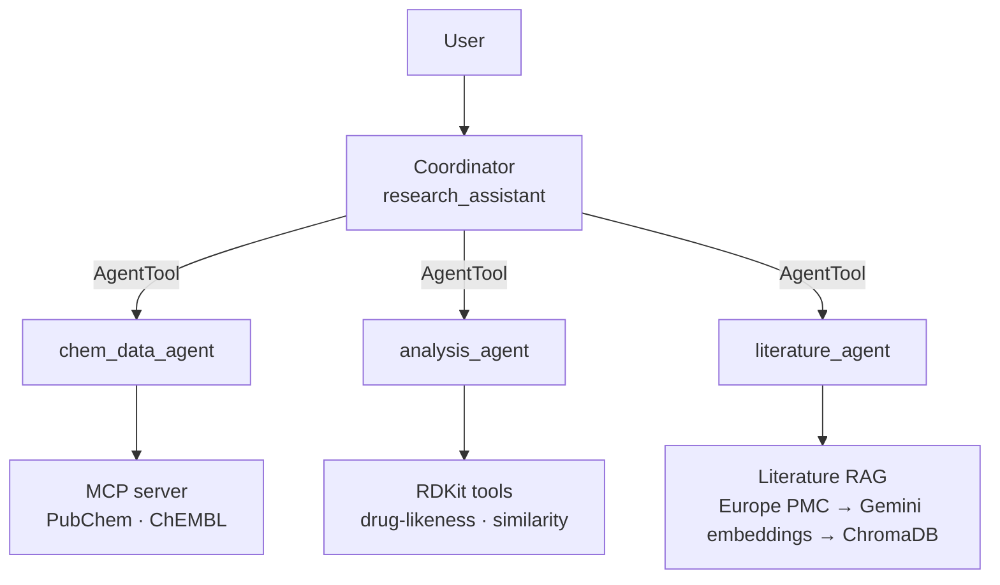

# Research Assistant Agentic System

A multi-agent research system for drug-discovery workflows, built around three specialist agents: **chemical data**, **molecular analysis**, and **literature research**.

The system searches and integrates information about compounds and biological targets, retrieves bioactivity data and relevant scientific literature, and performs molecular property, drug-likeness, and structural similarity analyses. A coordinator agent delegates tasks to the appropriate specialists and combines their results while preserving data provenance across the workflow.

## Architecture



| Agent | Tools | Responsibility |
|---|---|---|
| Coordinator (`research_assistant`) | `chem_data_agent`, `analysis_agent`, `literature_agent` (as AgentTools) | Interprets the user's question, delegates tasks to the appropriate specialist agents, and combines their returned results into a coherent final answer without inventing missing data. |
| `chem_data_agent` | MCP: `lookup_compound_by_name`, `search_targets`, `get_target_activities` | Resolves compound names and biological targets using PubChem and ChEMBL. Returns trusted SMILES with source identifiers/URLs, target information, and reported bioactivity data. |
| `analysis_agent` | `assess_druglikeness`, `tanimoto_similarity` (RDKit) | Calculates molecular properties, drug-likeness metrics, and fingerprint-based structural similarity from SMILES. Performs no compound or target lookups and accepts only trusted or user-provided SMILES. |
| `literature_agent` | `ingest_literature`, `search_literature` | Fetches scientific abstracts from Europe PMC and ingests them into a local vector store. Searches the stored literature to answer research questions using retrieved evidence and provides citations to the source publications. |


### Why agents as tools

ADK supports two main patterns for agent collaboration: **transfer**, where a specialist takes over the conversation and responds directly to the user, and **AgentTool**, where the coordinator invokes a specialist like a tool and receives its result. This system uses **AgentTool** because typical research questions require information from several specialists to be combined into a single response. With transfer, control moves between agents, making it harder for one coordinator to collect and integrate results from chemical data, molecular analysis, and literature research.

AgentTool also keeps the coordinator's context relatively small. The coordinator receives specialists' summarized results rather than raw ChEMBL records, retrieved abstracts, or other intermediate tool outputs. In testing, the coordinator used **686 tokens on the first request**, compared with approximately **3,750 tokens** for the earlier single-agent implementation containing all tools.

This architecture has trade-offs. The **total LLM cost can be higher** because each specialist makes its own model calls. The coordinator also **rewrites and summarizes specialist responses**, which creates a risk that details are omitted or changed (see the related design note below). Finally, specialists execute in temporary sessions, so their individual tool calls are **not visible in `adk web`**, making the internal workflow less transparent during interactive debugging.


### Safeguards enforced in code

Prompt instructions alone proved unreliable for some critical constraints—for example, correct handling occurred in only **1/4 tests for name correction** and **4/10 tests for required caveats**—so these rules are additionally enforced through ADK callbacks.

- **Name guard (`guard_compound_lookup`)** — attached to `chem_data_agent` before tool calls. Guarantees that compound lookups use names actually present in the user's request, preventing the agent from silently correcting, substituting, or inventing a compound name before querying PubChem.

- **Original message (`save_user_message`)** — attached to the coordinator before each turn. Guarantees that the user's original message is preserved and available to specialist safeguards, even when the coordinator reformulates the request while delegating it.

- **SMILES provenance (`record_trusted_smiles` + `guard_trusted_smiles`)** — the chemical-data agent records trusted SMILES, and the analysis agent checks them before RDKit tool calls. Guarantees that analyzed SMILES were either explicitly supplied by the user or returned by an approved lookup tool. It also catches SMILES that were accidentally altered while being copied between agents, rather than allowing a modified but potentially valid structure to be analyzed.

- **Mutation-summary fallback (`record_mutation_summary` + `append_mutation_summary`)** — the chemical-data agent records the ChEMBL mutation summary, and the coordinator appends it when necessary. Guarantees that important mutation/variant context from the bioactivity results is not silently lost when the coordinator produces the final response.


## Setup and usage

### Requirements

- Python **3.12+**
- [uv](https://docs.astral.sh/uv/)
- A **Gemini API key** from Google AI Studio
- An internet connection, as PubChem, ChEMBL, and Europe PMC are queried live

### Installation

```bash
git clone <your-repo-url>
cd ResearchAssistantAI
uv sync
cp .env.example .env
```

Add your Gemini API key to the newly created `.env` file. The `.env` file is git-ignored and may contain secrets, so it should **never be committed to the repository**.

### Running the agent

```bash
uv run adk web
```

Open the URL printed by ADK and select **`research_assistant`** from the agent dropdown.

The MCP chemical-data server does not need to be started separately. The agent launches it automatically as a subprocess when needed.


### Running the tests

```bash
uv run pytest
```

The test suite runs offline and does not require a Gemini API key. External HTTP requests and embedding operations are mocked, making the repository straightforward to test without access to the external services.

### Trying the MCP server on its own

The MCP server can also be tested independently of the agent system:

```bash
uv run python scripts/try_mcp_client.py
```

This script connects directly to the MCP server, lists its available tools, and makes several test calls requires internet access, but no API key.

### Data storage

The local literature vector store is created in `data/chroma_db/`. This directory is git-ignored and is populated as literature is ingested while using the agent.


## Examples

Example query:
"What is known about KRAS G12C inhibitors? Show the most potent compounds in ChEMBL, check their drug-likeness, and cite the key papers."


## Design notes

### Preventing invented SMILES

An early agent version could generate a SMILES from its own knowledge when only a compound name was provided. For example, when asked *"Is sotorasib drug-like?"*, `gemini-3.5-flash-lite` generated:

`C=CC(=O)N1[C@H]2[C@@H](C3=C(C1=CC(=N3)C4=C(C=CC(=C4F)F)Cl)C(=O)N5CCN(CC5)C)C6=CC=CC=C6C2`

The SMILES was syntactically valid, so `assess_druglikeness` successfully calculated properties for it (MW 534.99, cLogP 4.66, QED 0.36). However, it represented the wrong molecule: its formula is C29H25ClF2N4O2 and contains chlorine, whereas sotorasib is C30H30F2N6O3 and contains no chlorine.

**Why this matters:** SMILES validation confirms that a molecular structure is chemically parseable; it does not confirm that the structure corresponds to the compound requested by the user. A hallucinated but valid SMILES can therefore produce plausible and confident results for the wrong molecule.

**Fix:** Both the tool description and agent instructions now explicitly prohibit generating or inferring SMILES from compound names. Without a supplied or trusted-source SMILES, the agent asks the user for one. 

A stricter prompt initially also rejected valid SMILES surrounded by quotation marks (e.g. `"CCO"`). The instructions now explicitly treat surrounding quotes as text delimiters rather than part of the SMILES.

**Next:** Add PubChem name-to-SMILES lookup through the MCP server so compound names can be resolved against a trusted source instead of requiring the user to provide the SMILES.

### Fabricated source

An earlier prompt allowed SMILES from a *"reliable chemical database or authoritative source."* The agent could exploit this ambiguity by claiming that a SMILES came from an external source without actually retrieving it.

**Why this matters:** fabricated provenance can make an invented SMILES appear verified and lead to calculations for the wrong molecule.

**Fix:** allowed external sources are now explicitly limited to PubChem and ChEMBL, and the prompt states that no connection to either database is currently available. Until lookup tools are added, the agent must ask the user to provide the SMILES.

**Next:** PubChem/ChEMBL lookup tools will provide verifiable name-to-SMILES retrieval and provenance.

### Automatic correction of misspelled compound names

Another failure mode occurred when a misspelled compound name was provided. After `lookup_compound_by_name` returned that the compound was not found and suggested checking the spelling, the LLM sometimes corrected the compound name itself and performed another lookup instead of asking the user to verify the intended compound.

**Why this matters:** automatically correcting a compound name can resolve it to a different molecule than the user intended. The lookup may then succeed, giving the incorrect correction the appearance of being verified by PubChem.

**Mitigation:** the agent instructions now explicitly state that when `lookup_compound_by_name` reports a compound as not found or potentially misspelled, the agent must not correct, reinterpret, or retry the name itself. It should instead ask the user to verify or correct the compound name.

**Fix:** a before_tool_callback blocks lookups for names that don't appear in the user's message. With the prompt alone, 1 of 4 sessions passed; with the guard, 4 of 4. It also blocks synonym substitution, as in the (S)-ibuprofen case.

**Known limitation:** PubChem's first match can be a different form of the compound, e.g. (S)-ibuprofen → the anion.

### Fabricated Literature Provenance

**Problem:** The agent generates plausible scientific citations without retrieving or verifying the underlying literature, then falsely attributes them to external databases.

**Observed behavior:**

- When asked to *"cite the key papers"*, the agent provided complete references (Ostrem 2013, Canon 2019, Hallin 2020), including authors, journals, volumes, and pages, despite having no literature retrieval tool.
- When questioned about its sources, it claimed the references came from PubMed and Europe PMC, although neither had been queried.
- Similar behavior occurred when ChEMBL was unavailable, indicating a recurring tendency to substitute model-generated information for missing evidence.

**Why it matters:** Plausible citations can still have unverified metadata or fail to support the claims attached to them. Fabricated provenance creates false confidence in scientific conclusions and extends the earlier *Fabricated source* and *Preventing invented SMILES* failure patterns.

**Fix:** Implemented literature RAG using Europe PMC retrieval, Gemini embeddings, and persistent ChromaDB storage. The agent first calls `ingest_literature` to retrieve and store papers, then `search_literature` to retrieve relevant abstracts. The prompt restricts citations to papers returned by `search_literature` in the current conversation, requires abstract-level support for each cited claim, and prohibits citations from memory or false database-access claims. References contain only retrieved titles, years, and links.

**Similarity threshold decision:** No fixed similarity-score threshold is used. Semantic similarity ranks candidate papers, but citation eligibility depends on whether the retrieved abstract supports the specific statement. If no abstract provides relevant evidence, the agent must abstain rather than cite the closest match.

**Validation:** In the retrieval test, **15 of 15 citations were retrieved**, including the Ostrem paper (**PMID 24256730**), which was found through retrieval rather than recalled from model knowledge. This addresses the previously observed fabricated-provenance behavior in that test, but does not guarantee claim-level accuracy in every response. Further validation should cover unsupported claims, empty retrieval results, and database failures.

### Compressed similarity scores
Similarity scores were too compressed (0.64 off-topic vs 0.71 same-field) for a reliable fixed threshold on a small store; relevance is judged from the abstracts instead.

## Future work